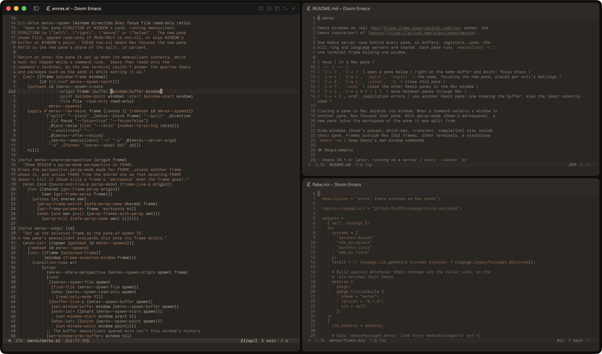

# emrex

Emacs windows as real [Rex](https://www.superlogical.com/rex) panes: the
Emacs counterpart of [neorex](https://github.com/alexrlocke/neorex).



One Emacs server runs behind every pane, so buffers, registers, undo, the
kill ring and language servers are shared. Each pane runs `emacsclient -t`:
one terminal frame holding one window.

| Keys | In a Rex pane |
| --- | --- |
| `C-x 2`, `C-x 3` | open a pane below / right on the same buffer and point; focus stays |
| `C-w s`, `C-w v`, `:split`, `:vsplit` | the same, focusing the new pane, placed per evil's settings |
| `C-x 0`, `C-w c`, `:close`, `:q` | close this pane |
| `C-x 1`, `:only` | close the other Emacs panes in the Rex window |
| `C-x o`, `C-w w W h j k l` | move between panes through Rex |
| `C-x 4 b`, xref, compilation errors | use another Emacs pane: one showing the buffer, else the least recently used |

Closing a pane in Rex deletes its window. When a command selects a window in
another pane, Rex focuses that pane. With persp-mode (Doom's workspaces), a
new pane joins the workspace of the pane it was split from.

Side windows (Doom's popups, which-key, transient, completion) stay inside
their pane. Frames outside Rex (GUI frames, other terminals, a standalone
`emacs -nw`) keep Emacs's own window commands.

## Requirements

- Emacs 30.1 or later, running as a server (`emacs --daemon` or
  `server-start`)
- Rex, with the `rex` CLI it ships (found through the pane's `REX_BIN_DIR`)

## Install

Doom (`packages.el`):

```elisp
(package! emrex :recipe (:host github :repo "Kahnix/emrex"))
```

```elisp
;; config.el
(use-package! emrex :config (emrex-mode 1))
```

`use-package` with Emacs 30's `:vc`:

```elisp
(use-package emrex
  :vc (:url "https://github.com/Kahnix/emrex")
  :config (emrex-mode 1))
```

Nix: add the flake as an input and build it with your own Emacs package set,
so the byte code matches your Emacs:

```nix
inputs.emrex = {
  url = "github:Kahnix/emrex";
  inputs.nixpkgs.follows = "nixpkgs";
};

# wherever you list Emacs packages:
extraPackages = epkgs: [ (inputs.emrex.lib.mkEmrex epkgs) ];
```

`overlays.default` adds `emacsPackages.emrex` instead.

## Usage

Start the Emacs server, turn on `emrex-mode`, and run `emacsclient -t` in a
Rex pane. A plain `emacs -nw` is not affected: new panes have to connect to
a server.

Rex starts a new pane's terminal at 80x24 and resizes it a moment later, so
a new pane waits for that resize (at most `emrex-resize-wait`, 1 second)
before starting `emacsclient`. Emacs then draws once, at the right size,
instead of drawing and reflowing.

Turn off Rex's setting that auto-balances splits if you want `C-u 20 C-x 2`
style sizes kept.

## Limitations

- `display-buffer` never opens a new pane. It must return a window at once,
  and a new pane's terminal can't answer Emacs's setup queries while a
  command runs, so with no other Emacs pane it splits inside the current
  one, as Emacs normally does.
- Rex moves focus relative to its focused pane, so `C-x o` from a pane that
  isn't focused (for example, keys sent with `rex send-key`) steps from the
  focused one.
- Only the sign of `C-x o`'s count is used.

## License

GPL-3.0-or-later.
